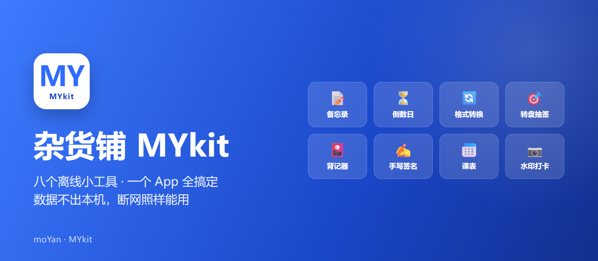
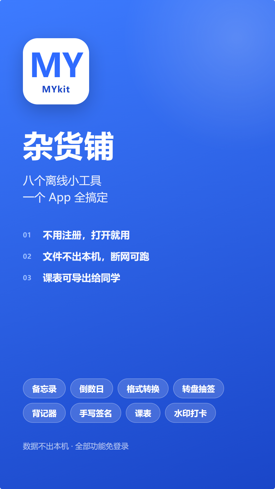
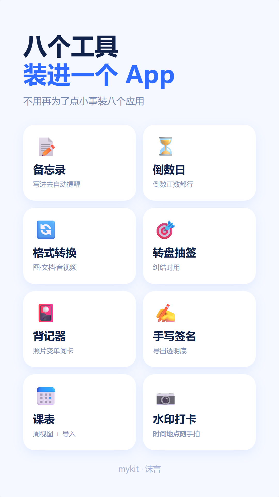
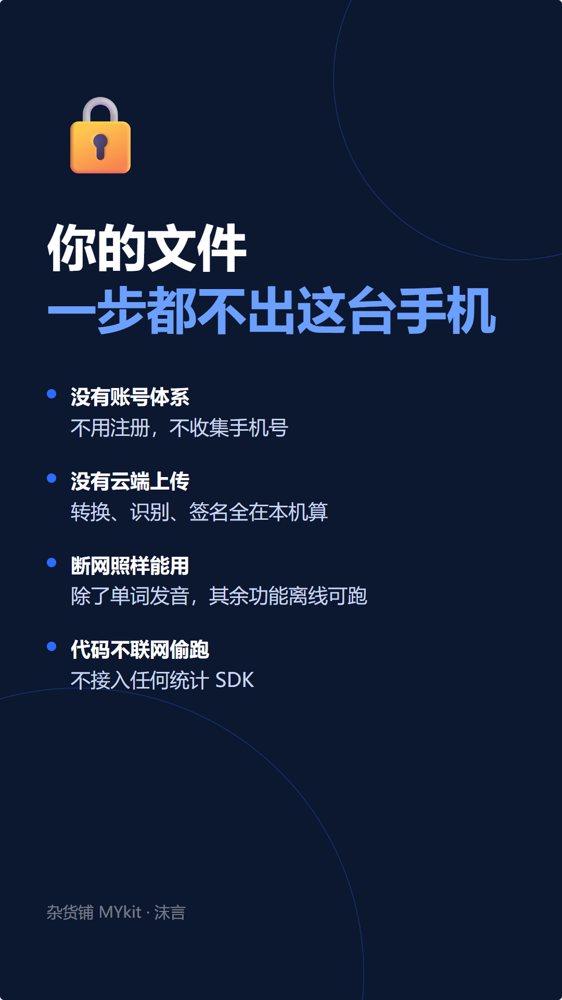
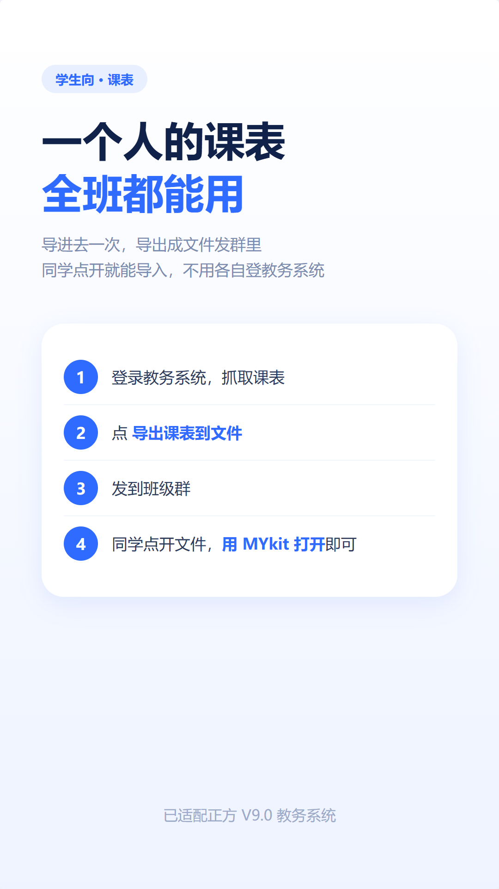

# 杂货铺 MYkit

  

  
  
  
  

  <b>八个离线小工具合一的安卓应用</b> 
  备忘录 · 倒数日 · 格式转换 · 转盘抽签 · 背记器 · 手写签名 · 课表 · 水印打卡

  <a href="../../releases/latest"><b>⬇ 下载最新版</b></a> ·
  <a href="#更新日志">更新日志</a> ·
  <a href="#反馈">反馈问题</a>

---

## 它解决什么问题

为了记个事装备忘录、为了算个日子装倒数日、为了转个格式装转换器、为了看课表装课程表 App……手机里塞了一堆只用一次的应用。

这个 App 把它们全装进一个：**八个功能，一个安装包，8 MB**。

而且**全部数据在本机处理**——没有账号、没有云端、不上传任何文件。

---

## 功能

| 工具 | 说明 |
| :--: | --- |
| 📝 **备忘录** | 记事，可一键写入系统日历提醒 |
| ⏳ **倒数日** | 倒数 / 正数都支持，带桌面小组件 |
| 🔄 **格式转换** | 图片→PDF、PDF→Word（OCR 版式还原）、Word→PDF、视频→mp3/m4a、文本→Excel |
| 🎯 **转盘抽签** | 纠结时让它决定，可自定义选项 |
| 🎴 **背记器** | 拍照识别文字做成记忆卡，真人发音朗读，美音/英音可切 |
| ✍️ **手写签名** | 手写后导出透明底 PNG，可直接贴到文档里 |
| 📅 **课表** | 周视图，支持正方 V9.0 教务系统导入、JSON 文件互传 |
| 📷 **水印打卡** | 拍照自动叠加时间、位置水印，可加备注 |

### 几个特别的设计

**课表可以互传**

一个人登录教务系统抓取课表，导出成 JSON 文件发到班级群，同学点开就能导入——不用每个人都去登一次教务系统。

怎么用：课表页 → ⚙ → **导出课表到文件** → 发微信/QQ → 对方点开选「用 MYkit 打开」。

**PDF 转 Word 保留原版式**

不是简单提取文字，而是渲染原页做底图、擦掉文字层、把识别出的文字按原坐标重新排成可编辑的文本框。所以图片、表格线、排版都还在。

**视频转音频不依赖 native 库**

用纯 Java 的 LAME 移植（jump3r）做 MP3 编码，不需要额外装 ffmpeg 或调用系统组件。

**单词发音是真人录音**

不依赖 TTS 引擎（很多国产 ROM 没装），联网取真人录音 mp3 后本地缓存，之后离线也能听。

---

## 海报

  
  
  
  

---

## 安装

1. 到 [**Releases**](../../releases/latest) 下载最新的 `mykit-x.x.x.apk`
2. 点击安装，首次需要在系统设置里允许「安装未知应用」
3. 覆盖安装即可升级，数据保留

**系统要求**

- Android 6.0（API 23）及以上
- arm64 设备

---

## 应用内更新

不用每次回来手动下载。

App 里 **设置 → 检查更新**，会读取这个仓库的 Release，发现有新版本后直接下载安装，进度条走完自动弹出安装器。

从 v1.1.0 起下载走 `api.github.com` 接口，国内通常 10~20 秒能下完。

---

## 反馈

**遇到问题请在这里开 Issue** —— 其他人可能也遇到了，公开讨论能留下记录。

  

提交前建议先看一眼 [已有的 Issue](https://github.com/MoYan-JY/MYkit/issues)，说不定已经有人报过、也有解决办法了。

### 提交时写清楚这几样

1. **用的哪个工具** —— 备忘录 / 课表 / 格式转换……
2. **具体操作步骤** —— 从打开 App 到问题出现，你点了什么
3. **看到的现象** —— 是闪退、卡住、结果不对，还是界面错位
4. **期望的结果** —— 你认为它应该是什么样

能带截图最好，特别是界面错乱、识别结果不对这类问题，一张图比一段字清楚。

App 里的「遇到问题？点这里反馈」会**自动附带**机型和系统版本（品牌、型号、Android 版本、ABI），但那只是帮你省掉抄写环境信息这一步。**问题现象本身还得你自己描述**——机型只能说明你用什么设备，说明不了你遇到什么。

### 其他联系方式

- 邮箱：3384230596@qq.com

---

## 说明

本仓库**仅用于发布安装包**，不包含源代码。

应用目前处于开发测试阶段，课表导入只验证过正方 V9.0 教务系统，其他系统可能解析不正确。遇到问题欢迎反馈。

---

  Made by 沫言 · 全部功能离线可用，数据不出本机

